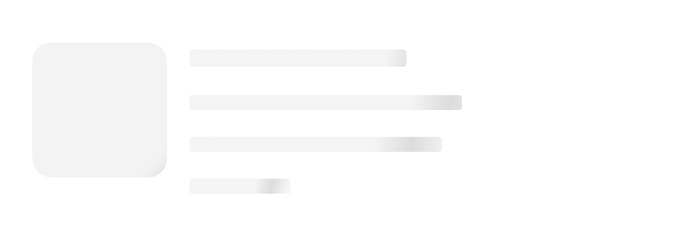

# ShimmerKit

A shimmer for SwiftUI loading placeholders that costs nothing once it's off screen.



```swift
import ShimmerKit

Text(post.title)
    .shimmering(isLoading: isLoading)  // redacts, shimmers, and disables hit testing while loading

Circle()
    .fill(.gray)
    .shimmering(active: photoURL != nil)
```

- The band position is computed from the clock in a `TimelineView` rather than a `repeatForever` animation. A `repeatForever` animation keeps running after its view leaves the screen (for example placeholders cached by a lazy stack), which kept an idle window at 15–70% CPU. The timeline is also paused while the view is off screen.
- Every shimmer on screen moves in sync. Pass `delay:` per row to make the band travel down a list; the lag stays the same forever.
- Stops moving when Reduce Motion is on, and mirrors in right-to-left layouts.
- `.shimmerGradient(_:)` changes the mask (for example a darker resting opacity on light backgrounds) for everything inside it.

Migrating from [SwiftUI-Shimmer](https://github.com/markiv/SwiftUI-Shimmer), which this is modeled on: replace `import Shimmer` with `import ShimmerKit`. `shimmering(active:)` keeps its meaning; `animation:` becomes `delay:`, `gradient:` becomes `.shimmerGradient(_:)`, and `bandSize:` / `mode:` are gone.
